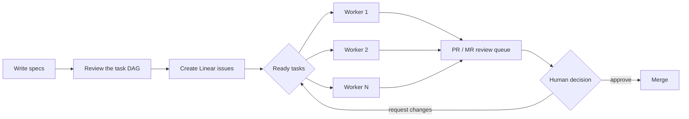
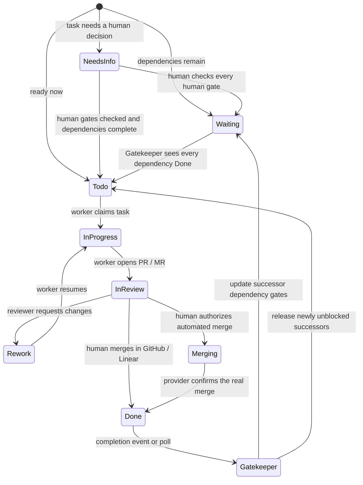

# AsyncSelf

> **Your background coding worker**
>
> You write the specs. AsyncSelf writes the code. You approve the merge.

[中文说明](README.zh-CN.md) · [Setup](docs/SETUP.md) · [Workflow](docs/WORKFLOW.md) · [Architecture](docs/ARCHITECTURE.md)

## Stop babysitting your coding agent

Coding agents make implementation faster, but the usual workflow still keeps the engineer in the
loop for the wrong reason: hand over one task, wait, inspect the result, then remember to feed the
next task. The code is faster; the queue is still manual, and focused work is interrupted all day.

AsyncSelf is the deliberately AFK-friendly version of that workflow. Write reviewed specs, turn
them into a dependency graph in Linear, and let isolated workers implement every ready task in
parallel. Come back when human judgment is useful: answer a question, review a pull request, or
authorize a merge.

> **Write the plan. Go AFK. Come back to pull requests.**
>
> **The engineer returns for decisions and reviews — not to keep the queue moving.**



AsyncSelf is a personal automation project built on OpenAI's Symphony preview. It combines the
Symphony orchestrator and dashboard with a spec planner, a dependency-aware Linear gatekeeper,
GitHub pull-request integration, a deterministic merger, and a GitLab merge-request watcher.

## What the loop does



- The spec planner turns a reviewed specification into a DAG and previews the Linear issues before
  anything is created.
- Symphony polls the configured Linear project, claims ready issues, creates isolated workspaces,
  and runs Codex workers concurrently.
- `Needs Info` requires an explicit checked `human:` gate in the issue description. A comment alone
  does not release the issue.
- `Waiting` becomes `Todo` only after every dependency is `Done` and every required gate is checked.
  Gatekeeper adds the required dispatch label before releasing the issue.
- Completing one issue updates its successors, so the next wave enters the queue without an
  engineer manually pushing it.
- `In Review -> Merging` is always a human decision. `Waiting Gatekeeper` is not presented as a
  successful merge; the dashboard says `PR merged` only after GitHub reports the real merged state.

See [the workflow guide](docs/WORKFLOW.md) for gate syntax, state transitions, failure behavior, and
the exact GitHub/GitLab merge paths.

## Human-owned merging

GitHub supports three review and merge paths:

1. Move the Linear issue from `In Review` to `Merging` in the AsyncSelf dashboard. Gatekeeper
   revalidates the repository, target branch, PR state, required checks, and head SHA, then performs
   a deterministic squash merge.
2. Merge the pull request directly in GitHub; Linear's GitHub integration reconciles the issue.
3. Merge through Linear Diffs; the native GitHub integration reconciles `Done`.

GitLab supports manual merge reconciliation and the Linear `Merging` flow through the MR watcher,
but its AsyncSelf dashboard experience is intentionally more limited than GitHub's. GitLab refers
to a compatible HTTPS GitLab host, not one hard-coded vendor deployment.

## Platform support

| Environment | Status | Notes |
|---|---|---|
| WSL2 | Recommended, tested | Best Windows experience; use the Linux filesystem for active repos and workspaces. |
| macOS | Tested for the GitLab profile | Use the same shell-based setup. |
| Linux | Primary target | The launcher and worker tooling are designed for a Unix-like environment. |
| Native Windows | Not recommended | Install WSL2 for process supervision, file permissions, shell tooling, and workspace isolation. |

For WSL2, keep active source clones and concurrent workspaces under paths such as `~/code`, not
`/mnt/c`, to avoid cross-filesystem performance and file-watching problems. Details are in
[Platform notes](docs/PLATFORMS.md).

## Requirements

- Linux, WSL2, or macOS
- [Codex CLI](https://developers.openai.com/codex/cli/) authenticated for the worker account
- a Linear workspace with the AsyncSelf states configured
- either GitHub plus `gh`, or a compatible GitLab host
- Git, Bash, Python 3, and `flock`
- [mise](https://mise.jdx.dev/) for the pinned Erlang/Elixir toolchain
- a source clone and a separate parent directory for isolated worker workspaces

Tokens and webhook secrets must live outside the repository. The examples expect
`$HOME/.config/asyncself/secrets.env`; never commit the real file.

## Quick start

1. Clone this repository as `asyncself` and install the Elixir toolchain:

   ```bash
   cd asyncself/elixir
   mise trust
   mise install
   mise exec -- mix setup
   cd ..
   ```

2. Copy one public profile and the external secret template:

   ```bash
   cp local-config/profiles/github.env.example local-config/profiles/github.env
   # Or: cp local-config/profiles/gitlab.env.example local-config/profiles/gitlab.env

   mkdir -p "$HOME/.config/asyncself"
   cp local-config/secrets.env.example "$HOME/.config/asyncself/secrets.env"
   chmod 600 "$HOME/.config/asyncself/secrets.env"
   ```

3. Fill the profile with your Linear project, source clone, workspace root, repository, required
   label, and a non-`main` target branch. Fill the external file with tokens.

4. Validate without starting services, then launch:

   ```bash
   ./start_asyncself.sh --profile github --check
   ./start_asyncself.sh --profile github
   ```

   Replace `github` with `gitlab` for that profile. The dashboard defaults to
   `http://localhost:4000`.

`start_symphony.sh` and the legacy `SYMPHONY_*` settings remain compatibility interfaces. New
installations should use `start_asyncself.sh` and `ASYNCSELF_*`; conflicting old and new values fail
closed instead of silently selecting one.

The full procedure, required Linear states, GitHub/Linear integration, GitLab host settings, and
configuration reference are in [Setup](docs/SETUP.md) and [Configuration](docs/CONFIGURATION.md).

## Bundled Codex skills

AsyncSelf ships project-scoped Codex skills under `.codex/skills/`. They cover the planning and
delivery operations that surround the background workers:

| Skill | Purpose |
|---|---|
| [`spec-planner`](.codex/skills/spec-planner/SKILL.md) | Turn a requirement into a reviewed task DAG and task-ready Linear issues. |
| `linear` | Read or update the active Linear issue through the workflow's Linear tools. |
| `commit` | Create a commit that records both the implementation and its rationale. |
| `pull` | Merge the configured target branch into the current worker branch safely. |
| `push` | Push a worker branch and create or update its pull request. |
| `debug` | Trace stuck or failed runs across issue, session, and runtime logs. |
| `land` | Shepherd an explicitly approved pull request through checks and conflicts. |
| `release` | Validate, version, tag, and publish an AsyncSelf source release. |

The worker-facing skills operate inside an issue workspace. `spec-planner` is different: it is the
intake layer that writes the issues AsyncSelf will later execute.

## `spec-planner`: from requirement to executable issues

Give the bundled `spec-planner` a rough requirement, project notes, a discussion, or existing
Markdown specs. It can write the complete set of Linear issues needed by the project, rather than
forcing you to prepare and submit each coding task manually.

Before it creates anything, the skill:

1. resolves blocking product and architecture questions;
2. chooses an independent-branch or integration-branch delivery strategy;
3. splits the work into an acyclic dependency graph;
4. writes one self-contained issue body per node, including context, scope, acceptance criteria,
   validation, labels, branch and PR/MR behavior, and Start Gates;
5. assigns the intended initial state: `Needs Info`, `Waiting`, or `Todo`;
6. previews the Mermaid graph, task table, issue bodies, creation order, and exact labels for human
   review.

Dependencies become structured `dep:` gates that Gatekeeper can release after predecessor issues
reach `Done`. Decisions that still belong to a person become `human:` gates and keep only the
affected issue in `Needs Info`. The result is a queue of task-ready issues that AsyncSelf can execute
in dependency order and in parallel where the graph permits it.

Open the repository in Codex and ask it to use `$spec-planner`, for example:

> Use `$spec-planner` to turn this requirement into an AsyncSelf DAG and draft the Linear issues.
> Show me the complete preview, branch plan, labels, and issue bodies before creating anything.

Preview and dry-run are safe and do not write to Linear. Live issue creation happens only after the
user explicitly approves the current preview. The skill then creates issues in topological order
and records their real Linear identifiers without printing the API key.

The skill calls the repository-owned deterministic pipeline through:

```bash
python .codex/skills/spec-planner/scripts/asyncself-pipeline preview SPEC.md --out OUTPUT_DIR
python .codex/skills/spec-planner/scripts/asyncself-pipeline apply OUTPUT_DIR/dag-plan.json
# After reviewing and explicitly approving the plan:
python .codex/skills/spec-planner/scripts/asyncself-pipeline apply OUTPUT_DIR/dag-plan.json --execute
```

Generated previews default outside the repository. See
[`spec-planner/SKILL.md`](.codex/skills/spec-planner/SKILL.md) for configuration, output files, and
the complete preview-and-approval contract.

## Deliberate limits

- AsyncSelf is an experimental personal automation project, not a hosted service or a promise of
  unattended production safety.
- It does not decide that code is good enough to merge. Humans own requirements, `Needs Info`
  decisions, review, and merge authorization.
- GitLab has fewer dashboard and PR/MR inspection features than GitHub.
- The first public snapshot has unit, syntax, configuration, and secret-pattern checks, but has not
  yet been revalidated from scratch on a clean machine with new public test accounts.
- Webhook mode is optional. Polling remains the baseline and avoids exposing a local receiver.

Read [Security](SECURITY.md) before giving tokens to a long-running worker.

## Documentation

- [Setup](docs/SETUP.md)
- [Configuration reference](docs/CONFIGURATION.md)
- [End-to-end workflow and Gatekeeper](docs/WORKFLOW.md)
- [Dashboard and merge controls](docs/DASHBOARD.md)
- [Architecture](docs/ARCHITECTURE.md)
- [Platform notes](docs/PLATFORMS.md)
- [Troubleshooting](docs/TROUBLESHOOTING.md)
- [Snapshot provenance](SHOWCASE_BASELINE.md)
- [Licensing boundaries](LICENSING.md)

## Origin and naming

AsyncSelf is derived from [OpenAI Symphony](https://github.com/openai/symphony). The public
snapshot records upstream commit `e0ccc83720a42a600a53b61c5f8d3e518bebe1db` as its baseline.
Internal Elixir module names, the core executable, and some compatibility paths intentionally keep
the Symphony name to make provenance and upstream comparison clear.

AsyncSelf is an independent project and is not endorsed by OpenAI.

## License

AsyncSelf is **source-available under mixed licensing**:

- the Symphony-derived core, direct modifications to it, launchers, public configuration, and
  documentation are licensed under Apache License 2.0, with upstream notices preserved;
- `local-tools/` and `.codex/skills/spec-planner/` are independently developed additions licensed
  under PolyForm Noncommercial 1.0.0;
- commercial use of the PolyForm-covered components requires a separate license from
  **mynewhao@foxmail.com**.

The exact path-based boundary and the rule for future Symphony changes are in
[LICENSING.md](LICENSING.md). Contributions are governed by [CONTRIBUTING.md](CONTRIBUTING.md).
