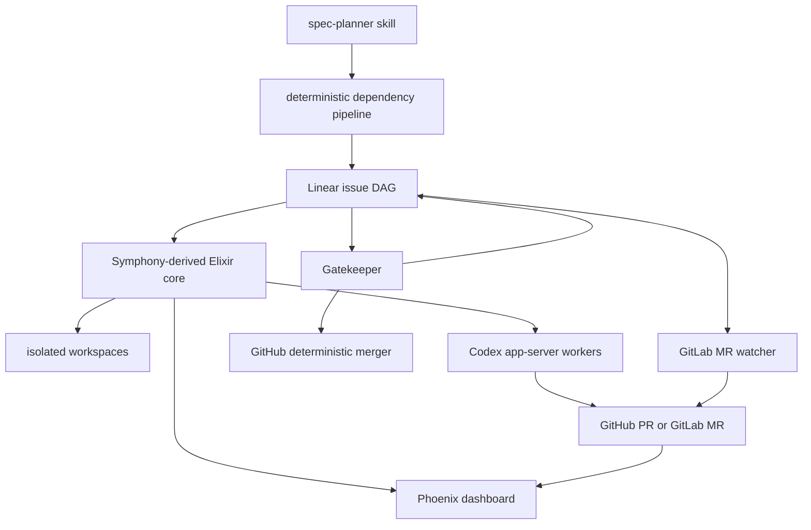

# Architecture

## Boundaries

- The **Symphony-derived core** polls the tracker, schedules concurrent workers, manages isolated
  workspaces, talks to Codex app-server, and serves the dashboard.
- The **spec planner skill** guides requirement clarification and invokes the repository-owned
  deterministic planner/applier. The skill contains instructions; it does not duplicate the
  implementation.
- The **dependency pipeline** validates DAGs, renders issue descriptions, applies approved plans to
  Linear, and evaluates gates.
- **Gatekeeper** owns dependency release, `Waiting`/`Needs Info` behavior, and deterministic merge
  authorization handling.
- Provider helpers reconcile GitHub PR or GitLab MR state. GitHub provides the richer dashboard
  integration.

Private runtime state, profiles, tokens, source repositories, and generated workspaces sit outside
the public source boundary. The sanitized snapshot intentionally contains only examples.

Internal `SymphonyElixir` module names and the `symphony` escript remain unchanged. Renaming them
would add migration risk without improving the public AsyncSelf interface; `start_asyncself.sh`
provides the product-level entry point.
